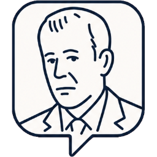

<p align="center">
  
</p>

# Toby

Toby is an AI assistant for your Mac. It is a single native macOS app that
connects to your Email, Slack, Apple Calendar, Reminders, Contacts, and macOS
controls so you can search, summarize, organize, and act on your work from
chat.

- **Chat** with personas, skills, and memories that keep context
- **Home** ranks what needs your attention across mail, calendar, todos, and Slack
- **Follow-ups** notice open loops and turn them into todos
- **Flows** run prompts and tools on a schedule or when something happens on your Mac
- **Recordings** transcribe meetings on-device and summarize them
- **Todos**, **projects**, and a **library** for your files
- **Sync & Backup** for todos across Macs and encrypted backups

AI goes through your [OpenRouter](https://openrouter.ai) account: sign in once
and Toby uses models from OpenAI, Anthropic, Google, and more. Your data stays
on your Mac; secrets live in the Keychain.

## Install

Download the latest release from
[www.tobyai.app](https://www.tobyai.app/docs/getting-started/install), or run:

```bash
curl -fsSL https://raw.githubusercontent.com/kshehadeh/toby/main/install-toby.sh | bash
```

Requires a Mac with Apple silicon running macOS 26 or later. Then open
**Settings → Account → Sign in with OpenRouter** and connect your sources under
**Settings → Sources**.

## Documentation

User documentation lives at [www.tobyai.app](https://www.tobyai.app) (source in
`apps/help-site/docs/`). Run it locally with `bun run docs:start`.

## Development

```bash
bun install          # help-site dependencies + git hooks
bun run app          # build and open dist/Toby (Dev).app
bun run test         # Swift tests
bun run lint         # Biome
```

The app is the Swift package in `apps/toby-app/`. Start with
[AGENTS.md](AGENTS.md) for architecture and conventions, and
[DESIGN.md](DESIGN.md) for UI work.
